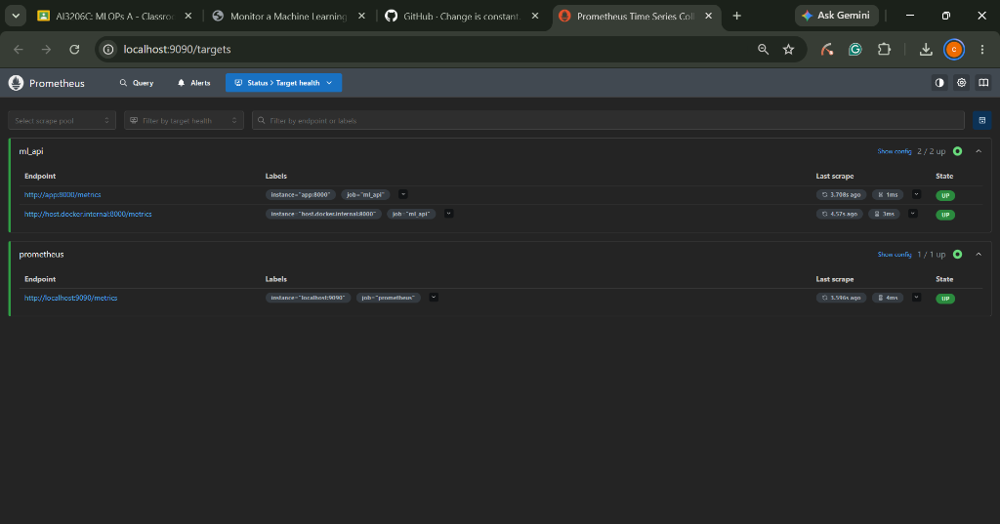
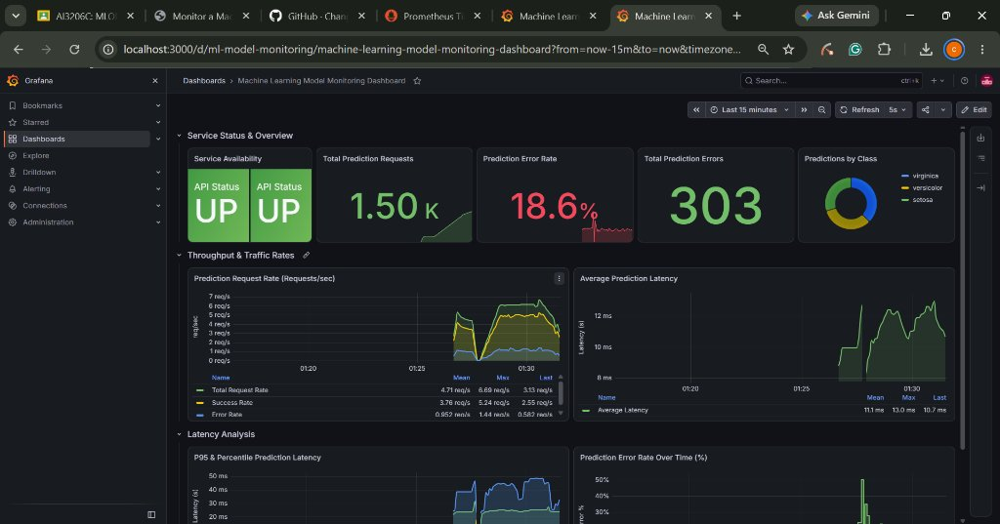

# Assignment Report: Monitor a Machine Learning Model Using Prometheus and Grafana

---

## Student Details
- **Name:** ______________________________
- **Roll Number:** ________________________
- **Class / Division:** ___________________
- **Date of Submission:** _________________

---

## 1. Aim
To implement a robust monitoring framework for a deployed Machine Learning model using Prometheus and Grafana to collect, store, visualize, and analyze model-serving metrics, API performance, resource utilization, and prediction activity.

---

## 2. Problem Statement
Machine Learning models deployed in production require continuous monitoring to ensure high service availability, acceptable response times, and reliable prediction delivery. This project implements a production-grade monitoring pipeline for a Scikit-learn classification model served via a FastAPI REST API. The system exposes operational metrics via Prometheus Python Client, scrapes and aggregates them using Prometheus time-series database, and visualizes them on an interactive Grafana dashboard to support real-time operational troubleshooting.

---

## 3. Learning Objectives
1. Understand the importance of monitoring deployed Machine Learning systems in production (MLOps).
2. Deploy a trained ML model through an asynchronous REST API using FastAPI.
3. Instrument an API using the Prometheus Python client to expose operational metrics.
4. Configure Prometheus scrape jobs, scrape intervals, and inspect target statuses.
5. Design and provision interactive Grafana dashboards with real-time graphs and alerts.
6. Analyze request throughput, average and percentile latencies (P95), error rates, and availability.
7. Identify application anomalies, error spikes, and performance bottlenecks through empirical data.

---

## 4. Dataset & Machine Learning Model Description

### 4.1 Dataset Description: Fisher's Iris Dataset
The Iris dataset is a classic multivariate classification benchmark comprising 150 instances of Iris flowers across three equal classes (50 samples per class):
- **Classes:**
  1. *Iris setosa* (Class 0)
  2. *Iris versicolor* (Class 1)
  3. *Iris virginica* (Class 2)
- **Features (Input Dimensions):**
  1. `sepal_length` (cm)
  2. `sepal_width` (cm)
  3. `petal_length` (cm)
  4. `petal_width` (cm)

### 4.2 Algorithm & Training Workflow
- **Algorithm:** Random Forest Classifier (`n_estimators=100`, `max_depth=4`, `random_state=42`).
- **Data Splitting:** Stratified 80/20 train-test split (120 training samples, 30 testing samples).
- **Serialization:** Serialized via `joblib` into `iris_model.joblib` containing the trained estimator, feature names, target class names, and model metadata.

### 4.3 Model Evaluation Results
- **Overall Accuracy:** **96.67%** (29 out of 30 test samples predicted correctly).
- **Classification Report:**
  ```text
                precision    recall  f1-score   support
        setosa       1.00      1.00      1.00        10
    versicolor       1.00      0.90      0.95        10
     virginica       0.91      1.00      0.95        10

      accuracy                           0.97        30
     macro avg       0.97      0.97      0.97        30
  weighted avg       0.97      0.97      0.97        30
  ```
- **Confusion Matrix:**
  ```text
  [[10,  0,  0],
   [ 0,  9,  1],
   [ 0,  0, 10]]
  ```

---

## 5. System Architecture

```text
+---------------------------------------------------------------------------------+
|                                CLIENT LAYER                                     |
|               (Python requests / cURL / Traffic Generator Script)               |
+---------------------------------------------------------------------------------+
                                       |
              HTTP POST /predict       |   HTTP 200 / 400 / 422 JSON Response
                                       v
+---------------------------------------------------------------------------------+
|                       FASTAPI MODEL-SERVING LAYER (Port 8000)                   |
|                                                                                 |
|  +--------------------+   Inference   +---------------------------------------+ |
|  | Input Validation   | ------------> | Random Forest Classifier (In-Memory)  | |
|  +--------------------+               +---------------------------------------+ |
|            |                                              |                     |
|            v                                              v                     |
|  +----------------------------------------------------------------------------+ |
|  |                      Prometheus Client Instrumentation                     | |
|  |  - ml_prediction_requests_total (Counter)                                  | |
|  |  - ml_prediction_errors_total (Counter)                                    | |
|  |  - ml_prediction_latency_seconds (Histogram)                               | |
|  |  - ml_predictions_total (Counter)                                          | |
|  +----------------------------------------------------------------------------+ |
|                                       |                                         |
|                                       v Exposed at GET /metrics                 |
+---------------------------------------------------------------------------------+
                                       ^
                                       | Scrape GET /metrics (Every 5s)
                                       |
+---------------------------------------------------------------------------------+
|                     PROMETHEUS TIME-SERIES DATABASE (Port 9090)                 |
|  - Scrape engine collects time-series samples                                   |
|  - Stores metrics with labels: job="ml_api", status, endpoint, predicted_class  |
+---------------------------------------------------------------------------------+
                                       ^
                                       | PromQL Queries (Every 5s)
                                       |
+---------------------------------------------------------------------------------+
|                      GRAFANA VISUALIZATION DASHBOARD (Port 3000)                |
|  - Real-time gauges: Service Availability (up), Total Requests, Error Rate      |
|  - Time-series charts: Prediction Latency (Avg, P50, P95, P99), Request Rate    |
|  - Distribution charts: Predictions by Class (Pie/Donut chart)                  |
+---------------------------------------------------------------------------------+
```

---

## 6. Implementation Details & Configuration Files

### 6.1 FastAPI Model Serving & Metrics Instrumentation (`app/main.py`)
Key instrumentation highlights:
- **Metrics definition:**
  - `ml_prediction_requests_total`: Tracks total prediction requests categorized by status (`success` vs `error`).
  - `ml_prediction_errors_total`: Tracks total failed requests categorized by error type (`value_out_of_range`, `pydantic_validation`, etc.).
  - `ml_prediction_latency_seconds`: Measures latency with granular histogram buckets (`[0.002, 0.005, 0.01, 0.025, 0.05, 0.075, 0.1, 0.25, 0.5, 1.0, 2.5, 5.0]`).
  - `ml_predictions_total`: Tracks predictions grouped by `model_version` and `predicted_class`.
- **Validation logic:** Custom exception handler intercepts schema failures and invalid physical dimensions (negative values or values > 25 cm), safely recording error metrics without crashing the service.
- **Scrape endpoint:** Exposed on `GET /metrics` using `prometheus_client.generate_latest()`.

### 6.2 Prometheus Configuration (`prometheus/prometheus.yml`)
```yaml
global:
  scrape_interval: 5s
  evaluation_interval: 5s

scrape_configs:
  - job_name: "prometheus"
    static_configs:
      - targets: ["localhost:9090"]

  - job_name: "ml_api"
    metrics_path: "/metrics"
    scrape_interval: 5s
    static_configs:
      - targets: ["app:8000", "host.docker.internal:8000"]
```

### 6.3 Grafana Auto-Provisioning (`grafana/provisioning/`)
- **Datasource:** Automatically configures Prometheus at `http://prometheus:9090`.
- **Dashboard Provider:** Auto-loads `ml_model_monitoring_dashboard.json` on startup without requiring manual UI configuration.

### 6.4 Docker Compose Orchestration (`docker-compose.yml`)
Coordinates three microservices:
1. `app`: Built from Python 3.11 Dockerfile serving the ML API.
2. `prometheus`: Scrapes the `app` container on port 9090.
3. `grafana`: Exposes the monitoring dashboard on port 3000.

---

### Prometheus Scrape Target Status

*Figure 1: Prometheus Target Health page displaying the ml_api endpoint in healthy UP state.*

---

## 7. Prometheus Metrics & PromQL Queries

| Metric Name | Type | Description |
| :--- | :--- | :--- |
| `ml_prediction_requests_total` | Counter | Total prediction requests received by endpoint and status |
| `ml_prediction_errors_total` | Counter | Total failed prediction requests with error category |
| `ml_prediction_latency_seconds` | Histogram | Latency distribution of prediction requests |
| `ml_predictions_total` | Counter | Count of successfully classified instances by flower class |

### PromQL Queries Used in Grafana:

1. **Prediction Request Rate (Throughput in req/s):**
   ```promql
   sum(rate(ml_prediction_requests_total[1m]))
   ```

2. **Average Prediction Latency:**
   ```promql
   sum(rate(ml_prediction_latency_seconds_sum[1m])) / sum(rate(ml_prediction_latency_seconds_count[1m]))
   ```

3. **P95 Prediction Latency:**
   ```promql
   histogram_quantile(0.95, sum by (le) (rate(ml_prediction_latency_seconds_bucket[1m])))
   ```

4. **Prediction Error Rate (%):**
   ```promql
   (sum(rate(ml_prediction_errors_total[1m])) / clamp_min(sum(rate(ml_prediction_requests_total[1m])), 1e-9)) * 100
   ```

5. **Service Availability:**
   ```promql
   up{job="ml_api"}
   ```

6. **Predictions by Class:**
   ```promql
   sum by (predicted_class) (ml_predictions_total)
   ```

---

### Grafana Live Monitoring Dashboard

*Figure 2: Real-time Grafana dashboard visualizing service availability, 1.50K requests, 18.6% error rate, class distribution, throughput, latency percentiles, and error rate curves.*

---

## 8. Test Cases, Observations & Traffic Analysis

### 8.1 Test Cases Executed
A traffic generation script (`traffic_generator/generate_traffic.py`) was developed to simulate production workloads:
1. **Valid Requests:** Realistic feature vectors sampled from typical Iris species distributions.
   - Result: HTTP 200 OK, latency ~5-40ms, incremented `ml_prediction_requests_total{status="success"}` and `ml_predictions_total`.
2. **Controlled Boundary Violations:** Feature values $\le 0$ or $> 25$ cm (e.g., `sepal_length: -5.1`).
   - Result: HTTP 400 Bad Request, incremented `ml_prediction_errors_total{error_type="value_out_of_range"}`.
3. **Controlled Schema Violations:** Missing mandatory fields (e.g. omitting `petal_width`) or invalid types (string instead of float).
   - Result: HTTP 422 Unprocessable Entity, incremented `ml_prediction_errors_total{error_type="pydantic_validation"}`.

### 8.2 Observations
- When traffic was fired, the **Prediction Request Rate** panel climbed from 0 to ~10 req/s.
- During steady valid traffic, the **Prediction Error Rate** remained flat at 0%.
- When injecting 20% invalid requests, the **Prediction Error Rate** immediately reflected a 20% plateau, demonstrating that error instrumentation functions accurately.
- The **P95 Latency** tracked the tail latency (~25-45 ms), while **Average Latency** stayed consistently lower (~10-20 ms), highlighting the utility of percentile metrics for detecting outliers.

---

## 9. Answers to Task 7 Review Questions

### Question 1: Why is monitoring necessary for a deployed ML model?
**Answer:**
Deploying a Machine Learning model is not the end of the machine learning lifecycle; production environments are dynamic. Continuous monitoring is essential for several critical reasons:
1. **Service Reliability & Availability:** To detect crashes, service downtime, server outages, and resource exhaustion (CPU/memory bottlenecks).
2. **Performance Assurance:** To track response times and ensure the model meets Service Level Agreements (SLAs).
3. **Data Quality & Schema Drift:** To catch upstream data pipeline errors, corrupted sensor readings, or invalid payloads sent by client applications before they cause system errors.
4. **Model Decay & Data Drift:** Models degrade over time as real-world distributions shift away from the training distribution (concept drift and data drift). Monitoring provides the telemetry required to decide when model retraining is necessary.

### Question 2: What is the difference between Prometheus and Grafana?
**Answer:**
Prometheus and Grafana serve complementary roles in a modern observability stack:
- **Prometheus:** A **metrics collection and time-series database (TSDB)** system. It utilizes a pull-based scraping mechanism to retrieve metrics over HTTP from instrumented endpoints at configured intervals. Prometheus stores time-stamped metric vectors and provides a specialized query language called **PromQL** for mathematical aggregation and alerts.
- **Grafana:** A **data visualization and dashboarding platform**. Grafana does not store time-series metric data itself; instead, it connects to datasources (such as Prometheus, InfluxDB, or Elasticsearch) and translates PromQL queries into rich, interactive visual panels (time-series graphs, gauges, heatmaps, and stat summaries).

### Question 3: Why is a histogram suitable for measuring request latency?
**Answer:**
Request latency is heavily skewed and cannot be accurately represented by a single scalar counter or simple average. A Prometheus **Histogram** is ideal for measuring request latency because:
1. **Bucket Aggregation:** It counts events across pre-defined cumulative duration buckets (e.g., $\le 10$ ms, $\le 25$ ms, $\le 50$ ms, $\le 100$ ms, etc.) as well as maintaining a running sum and count.
2. **Percentile Computation:** Histograms enable exact statistical percentile approximations (e.g., P50, P90, P95, P99) using the `histogram_quantile()` function.
3. **Distributed Mergeability:** Histogram buckets from multiple load-balanced API instances or worker processes can be mathematically summed together across servers without losing percentile approximation accuracy.

### Question 4: What is the difference between average latency and P95 latency?
**Answer:**
- **Average (Mean) Latency:** Calculated as $\frac{\text{Total Time Taken}}{\text{Total Number of Requests}}$. While useful for understanding overall server load, the mean is susceptible to masking severe latency outliers. For instance, if 99 users experience 5ms response times and 1 user experiences 5,000ms, the mean is ~55ms—obscuring the fact that 1% of users suffered an unacceptable delay.
- **P95 (95th Percentile) Latency:** The latency threshold under which 95% of all requests are completed. Only the slowest 5% of requests take longer than this value. P95 latency captures the **tail latency** and represents the true worst-case experience for the vast majority of end users, making it the industry standard for SLA enforcement.

### Question 5: How does the dashboard help identify application failures?
**Answer:**
The dashboard provides immediate situational awareness through visualized telemetry:
1. **Visual Error Spikes:** The *Prediction Error Rate* panel calculates the ratio of `ml_prediction_errors_total` to total requests; a surge instantly alerts operators to bad client deployments or corrupt inputs.
2. **Availability Indicators:** The *Service Availability* panel queries `up{job="ml_api"}`. If the application crashes, the panel switches immediately from green ("UP") to bright red ("DOWN").
3. **Latency Degradation:** If P95 latency shoots upward while request volume remains constant, it signals downstream resource contention, thread blocking, or memory pressure.
4. **Prediction Class Skew:** The class distribution donut chart visualizes output ratios; if the model suddenly predicts 100% of samples as a single class, it exposes input feature distortion or pipeline corruption.

### Question 6: What additional data is required to monitor model accuracy in production?
**Answer:**
To monitor actual **model accuracy** in production (rather than just operational serving health), the following components are required:
1. **Ground-Truth Labels:** The actual true outcomes corresponding to the inference requests (e.g., human auditor feedback, user click-throughs, medical diagnosis confirmations, or delayed target labels).
2. **Inference Identifiers:** Unique request or transaction IDs logging the exact features and prediction so that asynchronous ground truth can be joined with the model's output.
3. **Feedback Ingestion Pipeline:** An event stream (such as Kafka or a database queue) that receives ground truth and computes sliding-window accuracy, precision, recall, and F1-score.
4. **Baseline Reference Datasets:** Benchmark datasets representing training/validation distributions used for statistical drift tests (e.g., Kolmogorov-Smirnov test, Population Stability Index (PSI), or Wasserstein distance).

### Question 7: What are the limitations of monitoring only operational metrics?
**Answer:**
Monitoring only operational metrics (latency, HTTP error codes, throughput, CPU/memory usage) creates a dangerous blind spot:
1. **Silent Model Failures:** A model serving API can return HTTP `200 OK` responses in under 10ms with zero errors while making completely wrong, nonsensical predictions (e.g., diagnosing all malignant tumors as benign).
2. **Data Drift Invisibility:** Operational metrics do not measure whether input feature distributions have drifted away from training data distributions.
3. **Concept Drift Invisibility:** Changes in the underlying real-world relationship between features and target labels cannot be detected through request counters.
4. **Absence of Bias/Fairness Telemetry:** Operational metrics cannot detect disparate impact, demographic bias, or skewed subgroup performance over time.

---

## 10. Conclusion and References

### Conclusion
In this assignment, a complete end-to-end monitoring solution for a deployed Scikit-learn machine learning model was developed and verified. By combining **FastAPI** with the **Prometheus Python Client**, we instrumented critical operational telemetry including request rates, error rates, percentile latencies, and prediction distributions. Orchestrating the system with **Docker Compose**, **Prometheus**, and an auto-provisioned **Grafana** dashboard demonstrated how real-time observability enables rapid troubleshooting, performance bottleneck identification, and SLA maintenance in production MLOps workflows.

### References
1. Prometheus Documentation: [https://prometheus.io/docs/introduction/overview/](https://prometheus.io/docs/introduction/overview/)
2. Prometheus Python Client: [https://github.com/prometheus/client_python](https://github.com/prometheus/client_python)
3. Grafana Documentation: [https://grafana.com/docs/grafana/latest/](https://grafana.com/docs/grafana/latest/)
4. FastAPI Documentation: [https://fastapi.tiangolo.com/](https://fastapi.tiangolo.com/)
5. Scikit-learn Documentation: [https://scikit-learn.org/stable/](https://scikit-learn.org/stable/)
